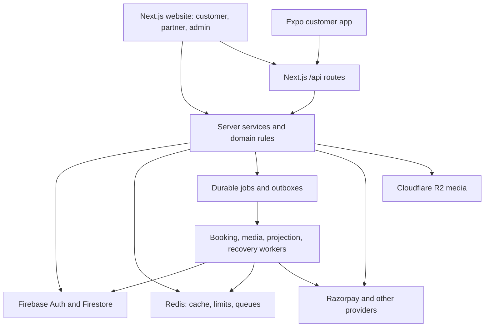
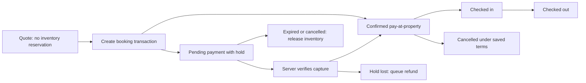

# Helpkey website, backend, and mobile app analysis

Reviewed: 10 November 2026, Asia/Kolkata. Scope: the local `web/` and `app/` checkouts.

## 1. Main conclusion

The shared-backend approach already exists in this project. The website is a Next.js application that also hosts the backend; the Expo app calls its `/api/*` routes. You do not need to rebuild booking, inventory, authentication, payments, or property management for mobile.

The mobile app already has a substantial customer journey: onboarding, OTP/Google authentication, home, search, filters, hotel details, public reviews, checkout, native Razorpay, payment retry/recovery, booking lists, cancellation, profile, and local saved hotels. The remaining work is **contract alignment and customer feature parity**, followed by device verification.

Several mismatches affect existing functionality and should be fixed before adding screens. Most notably, checked-in/out bookings disappear from the mobile list, dated stay totals are labelled per night, and checkout does not submit the backend's optional protection against changes to the quote the guest reviewed.

This is a repository architecture and integration audit, with focused runtime reproductions and local checks. It is not a claim that every line has been audited or that a deployed environment, live payment, native build, or production database has been verified. No application behavior, environment values, or live records were changed.

Companion documents:

- [Implementation checklist](/Users/zrf/ABHI/Freelance/Helpkey/web/docs/APP_IMPLEMENTATION_CHECKLIST.md)
- [Complete API route inventory](/Users/zrf/ABHI/Freelance/Helpkey/web/docs/APP_API_INVENTORY.md)

## 2. Architecture and responsibilities

Some website pages call server services directly for server rendering. Mobile must consume the corresponding HTTP contract; copying a page component does not reproduce its server data access.

| Area | Current implementation | Responsibility when adding mobile features |
| --- | --- | --- |
| Website | Next.js 16.3.3, React 19.2.8, TypeScript, Tailwind | Reference behavior and browser UI |
| Backend | Next.js route handlers, Zod, Firebase Admin | Authentication, authorization, pricing, inventory, transactions, provider verification |
| Mobile | Expo 57, React Native 0.86.3, Expo Router, React Query | Native screens, input, navigation, token storage, payment presentation |
| Database | Firestore | Shared source records and booking snapshots |
| Cache and delivery | Redis, BullMQ, durable Firestore jobs/outboxes | Fast reads, rate limits, delivery and recovery |
| Media | R2, signed upload/preview flows, media worker | Public approved media and private documents |
| Payments | Razorpay orders, signed callbacks/webhooks, reconciliation/refunds | Server-authoritative financial state |

These versions come from the checked-out package manifests, not a recommendation to upgrade. `web/` and `app/` are separate Git repositories with separate dependencies; the parent folder is not a configured shared-package workspace.

### Where to look in the code

| Concern | Website/backend source | Mobile source |
| --- | --- | --- |
| HTTP contracts and errors | `web/lib/api/`, `web/app/api/` | `app/src/lib/api/` |
| Identity/session | `web/lib/auth/`, `web/types/auth.ts` | `app/src/features/auth/` |
| Discovery and selected offers | `web/lib/customer/`, `web/lib/services/public-stay.ts` | `app/src/features/home/`, `search/`, `hotel/` |
| Booking orchestration | `web/lib/bookings.ts`, `web/lib/booking/` | `app/src/features/checkout/`, `bookings/` |
| Extras and pre-check-in | `web/lib/stay/`, `web/components/stay/` | No equivalent feature module found |
| Partner operations | `web/lib/partner/`, `web/components/partner/` | No partner routes found |
| Admin operations | `web/lib/admin/`, `web/components/admin/` | No admin routes found |
| Async processing | `web/lib/background/`, `web/workers/` | No mobile equivalent needed |

### Shared data model

| Records | Purpose and mobile consequence |
| --- | --- |
| Firebase identity, `users`, `otpChallenges` | Same UID on both clients; profile/role/account state is server-controlled. |
| `properties`, `propertyMemberships` | Listing source and property-scoped staff access; public hotel DTOs deliberately omit private fields. |
| `roomTypes`, `ratePlans`, `cancellationPolicies` | Sellable accommodation and published terms; a property is not itself a fixed-price product. |
| `inventoryCalendars`, `inventoryHolds`, legacy `roomNightInventory` | Interval capacity/holds alongside legacy overnight inventory; the property engine determines the path. |
| `bookings` and booking `events` | Saved reservation, price/terms, revisions and audit trail; detail should use this snapshot. |
| `paymentAttempts`, `paymentWebhookEvents`, `refunds` | Verified captures, webhook processing and durable refund work; mobile must display server state. |
| `stayQuoteOrders`, booking `customizations` and `stayPaymentReceipts` | Separate request agreements and additional-payment identity/ledger. |
| `users/{uid}/savedProperties` | Actual account wishlist location; the older specification's top-level wishlist concept is not the current implementation. |
| Reviews, `reviewPhotos`, `pendingUploads` | Review eligibility, owner photos and staged upload/publication. |
| `mediaAssets`, verification documents, public projections | Public image delivery and private KYC are different access paths. |
| `notifications`, `bookingNotificationOutbox` | User feed plus durable booking-notification delivery. |
| Background jobs/outboxes, derived search/review metrics | Rebuildable processing/read models; never a second source of truth for financial decisions. |

Exact DTOs remain the client boundary; mobile should not read these operational collections directly.

### Booking lifecycle to preserve

The server also supports no-show and payment-failure cases. Provider dismissal is a client payment-attempt outcome and does not necessarily cancel the held booking. Display each state explicitly rather than deriving success from a payment sheet closing.

## 3. What the website/backend implements

### Customer discovery

Home recommendations and destinations; suggestions; filtered and sorted hotel search; dated availability; hourly and overnight stays; hotel gallery, amenities, rules, location, reviews, rooms and rates. Search now selects an actual eligible room/rate offer and derives its total, amenities, cancellation and breakfast claims from that offer.

The shared search service filters and sorts before pagination. It returns result totals, amenity facets, evaluation/expiry timestamps and selected offers. The website can request a bounded complete client snapshot for local filtering. Search is bounded at 1,000 candidate properties; hotel room/rate catalogs also have limits. These are operational limits to measure, not unlimited global search.

### Booking and money

Server quotes validate property/room/rate status, dates or hourly duration, capacity, pricing, taxes/fees, payment mode, cancellation and extras. Money uses integer paise. Inventory supports legacy overnight records and an interval engine shared by hourly and overnight reservations. Hourly prices use explicit whole-hour duration totals, with 15-minute arrival steps.

Booking creation uses an idempotent booking identity, creates inventory holds transactionally, snapshots terms, and creates/reuses a Razorpay order when required. Full payment, deposits and pay-at-property rates exist. The server verifies provider capture, order identity, amount and currency before confirming. Duplicate payment events are guarded; captures after a hold is lost enter refund processing.

Workers expire holds, reconcile interrupted orders/payments, process refunds and publish booking notifications. These processes are part of the backend required by both clients.

### After booking

The website has booking lists and an itinerary, payment retry, receipts, guest/contact/billing information, saved policies and amenities, cancellation information, pre-check-in, arrival updates, stay requests and separate payments for hotel-quoted extras. Review creation/editing and review photo upload/finalization are implemented.

Stay personalization is a substantial feature: traveler preferences, free and immediately charged extras, approval requests, variants/choices/quantities, guest inputs, unlisted requests, versioned hotel quotes, accept/decline, supplemental payments, preparation states and saved agreements. Its supplemental payment ledger is separate from the original room payment.

### Partner and admin

Partner functionality includes onboarding, property/KYC/media submission, rooms/rates/cancellation policies, listing changes, dashboard/reporting, reservation search/export, manual bookings, room allocation, property-side collections/reversals/refunds, amendments, check-in/out, inventory blocks, housekeeping, review replies, and stay offering/request management.

Admin functionality includes overview, users, properties/partners and approval review, asset/KYC inspection, property lifecycle, bookings and financial timelines, refund retry, review moderation, worker/projection/media operations, an Aadhaar lab and privacy-request viewing. Role checks and property membership checks belong on the server; mobile UI restrictions cannot replace them.

### Features that should not be assumed complete

The database specification and platform checklist contain future product scope. They are not proof of implementation. This audit found no corresponding complete API/screen implementation for wallet/loyalty, general coupon redemption, automated partner settlement/payouts, or customer live chat/support tickets. Help content is not a ticketing backend. Notifications are an in-app feed; mobile push and general email/SMS/WhatsApp booking delivery are separate work. WhatsApp OTP delivery already exists for authentication.

Account deletion currently means submitting a request for manual verification/processing, not immediate deletion. Profile display is present; a general customer profile-update API was not found in the inspected route inventory.

## 4. Customer parity matrix

“Present” means code exists, not that it was verified on an installed phone during this audit.

| Feature | Website/backend | Mobile | Assessment |
| --- | --- | --- | --- |
| OTP and Google sign-in | Present | Present, bearer tokens and secure storage | Reuse; verify on Android/iOS |
| Session restoration and refresh | Cookie sessions plus ID-token verification | Present, single-flight refresh and one 401 retry | Existing foundation |
| Home and destinations | Present | API-connected | Broadly present |
| Search/filter/sort | Server-authoritative offer selection | Present with older client filtering assumptions | Align contracts |
| Search offer price/deadline/facets | Present | Selected offer and expiry metadata discarded | Important gap |
| Hourly booking | Present | No stay-mode/arrival/duration contract | Missing across the journey |
| Hotel gallery/location/public reviews | Present | Present, Maps handoff | Native UX verification needed |
| Guest policies and house rules | Structured fields returned | Not retained by detail parser | Missing |
| Room/rate selection and quote | Present | Overnight implementation present | Align evaluated prices and metadata |
| Guest names/contact/GST invoice | Present | Names, lead contact and GST form present | Separate booking contact and identity-flow parity missing |
| Quote-change protection | Expected amount and fingerprint supported | Not sent | Correctness gap |
| Native booking/payment/retry | Shared backend | Present | Preserve; harden recovery boundaries |
| Booking lists and cancellation | Present | Present | Status compatibility bug |
| Itinerary and booking details | Present | “View Details” opens public hotel | Missing |
| Receipt, balances and refund details | Present | Summary subset only | Missing |
| Pre-check-in and arrival | Present | No consumer found | Missing |
| Checkout extras/preferences | Present | No consumer found | Missing |
| Hotel quote accept/decline/payment | Present | No consumer found | Missing |
| Review submission/edit/photos | Present | Public reviews are read-only | Missing |
| Account wishlist | Present | Global device-local store | Not synchronized |
| Notifications feed/read state | Present | No consumer found | Missing |
| Privacy/deletion entry points | Website pages and request endpoint | Profile links only to Help | Missing direct entries |
| Partner/admin workspaces | Present on web | No routes found | Separate scope decision |

## 5. Prioritized findings

### F1 — High: valid bookings silently disappear after check-in/out

The mobile parser accepts six booking states but excludes `checked_in` and `checked_out`. The backend serializes those states and maps legacy `completed` to `checked_out`. The parser discards unsupported records, so operationally valid bookings disappear rather than changing labels.

Evidence: [mobile status allowlist](/Users/zrf/ABHI/Freelance/Helpkey/app/src/features/bookings/model.ts:33), [backend normalization](/Users/zrf/ABHI/Freelance/Helpkey/web/lib/booking/domain.ts:143), [serialized status](/Users/zrf/ABHI/Freelance/Helpkey/web/lib/bookings.ts:768). A local pure-function reproduction returned one row for `confirmed` and zero for each of `checked_in`, `checked_out`, and `completed`.

Implement canonical statuses, explicit in-house/completed views and safe handling of unknown future states. Also support historical bookings without a public property slug; currently those are discarded too. Keep access to a booking independent of whether its hotel is still publicly bookable.

### F2 — High: dated totals are displayed as nightly prices

For dated search, `minimumPricePaise` is the selected offer's **whole-stay total**. The mobile result card prints that value with `/night`. A two-night total of ₹6,000 therefore appears as ₹6,000/night. Mobile also discards the selected room/rate IDs and opens hotel details without preserving that exact offer.

Evidence: [backend selected price](/Users/zrf/ABHI/Freelance/Helpkey/web/lib/customer/catalog-selection.ts:84), [mobile result label](/Users/zrf/ABHI/Freelance/Helpkey/app/src/app/search-results.tsx:200), [mobile catalog parser](/Users/zrf/ABHI/Freelance/Helpkey/app/src/features/home/parse.ts).

Retain `offer`, display a clearly labelled total for dated stays, and carry room/rate identity into hotel selection. Undated home prices also need a defined basis because the backend can derive starting prices from hourly rates.

### F3 — High: checkout does not protect the quote the guest reviewed

The backend accepts `expectedTotalPaise` and `quoteFingerprint` and rejects changes with `QUOTE_CHANGED`. Mobile's quote parser omits the fingerprint and `buildBookingBody` sends neither protection. The server still calculates authoritative prices, but it can create a booking using a different price/terms from the quote the guest saw.

Evidence: [server guards](/Users/zrf/ABHI/Freelance/Helpkey/web/lib/bookings.ts:533), [mobile quote model](/Users/zrf/ABHI/Freelance/Helpkey/app/src/features/hotel/types.ts:90), [booking body](/Users/zrf/ABHI/Freelance/Helpkey/app/src/features/checkout/form.ts:120).

Submit both values from the quote actually accepted. On change, refresh and require review before retrying. Preserve idempotency for unchanged requests and avoid creating a second booking after an ambiguous create response.

### F4 — High: cancellation copy can promise free cancellation despite a fee

When policy description is empty, `cancellationSummary` calls a positive cancellation window “Free cancellation” without checking the fee percentage or whether the deadline has passed. Reproduction with a 24-hour window and 50% fee produced “Free cancellation until 24 hours before check-in.”

Evidence: [summary function](/Users/zrf/ABHI/Freelance/Helpkey/app/src/features/hotel/pricing.ts:151), [server cancellation terms](/Users/zrf/ABHI/Freelance/Helpkey/web/lib/customer/offer.ts).

Use the saved/evaluated fee, exact deadline and property timezone. Show refund terms before the guest confirms cancellation; the current mobile confirmation only warns that cancellation cannot be undone.

### F5 — Medium: mobile search uses an obsolete filtering strategy

The app withholds price bounds unless sorting by price, and filters cancellation locally. The current backend can combine these filters with all supported sort modes before pagination and choose the qualifying room/rate offer. Local cancellation filtering may discard a hotel whose initially selected offer is nonrefundable even though another eligible rate has free cancellation.

Evidence: [app search plan](/Users/zrf/ABHI/Freelance/Helpkey/app/src/features/search/criteria.ts:147), [server selection](/Users/zrf/ABHI/Freelance/Helpkey/web/lib/customer/catalog-selection.ts:71). A local reproduction confirmed that enabling free cancellation adds no such filter to the outgoing query.

Send the full normalized criteria to the server; retain exact totals/facets and explicit expired-cursor recovery. The mobile model also lacks location/place inputs, multiple property types and several supported sorts. Those are parity features, after correctness.

### F6 — Medium: freshness assumptions no longer match offer expiry

Mobile defaults query freshness to 60 seconds and discards search/bookable `expiresAt`, offer `validUntil`, and `serverNow`. Backend search/availability snapshots last at most 30 seconds and can expire earlier at a business deadline. React Query becoming stale also does not itself invalidate a visible price at that deadline.

Evidence: [mobile defaults](/Users/zrf/ABHI/Freelance/Helpkey/app/src/lib/query/client.ts:9), [availability expiry](/Users/zrf/ABHI/Freelance/Helpkey/web/lib/services/public-stay.ts), [search rollout](/Users/zrf/ABHI/Freelance/Helpkey/web/docs/SEARCH_CUSTOMER_EXPERIENCE.md).

Retain expiry metadata, account for server time, refresh expired offers and make pending/stale selections non-actionable. Final booking validation already remains server-authoritative.

### F7 — Medium: wishlist is shared by the device, not the account

The app stores everything under `hk.wishlist.v2` and still comments that no wishlist API exists. The backend now provides authenticated GET/PUT/DELETE wishlist routes. Current saved items do not synchronize to the website and are not separated when accounts switch on the same device.

Evidence: [mobile store](/Users/zrf/ABHI/Freelance/Helpkey/app/src/features/wishlist/store.ts:7), [server wishlist routes](/Users/zrf/ABHI/Freelance/Helpkey/web/app/api/wishlist/route.ts).

Add PUT/DELETE support to mobile HTTP transport, account-keyed query state, optimistic rollback and a deliberate guest-local migration policy. Do not silently import one person's device list into another account.

### F8 — Medium: “View Details” is not a booking detail flow

The booking card navigates to `/hotels/[hotelId]`, which shows the current public property rather than the saved booking. No mobile booking-detail route consumes `GET /api/bookings/[bookingId]`. This blocks reliable historical details, receipt, refund/balance information and all post-booking stay controls.

Evidence: [booking card navigation](/Users/zrf/ABHI/Freelance/Helpkey/app/src/app/bookings.tsx:44), [existing detail API](/Users/zrf/ABHI/Freelance/Helpkey/web/app/api/bookings/[bookingId]/route.ts).

Add a booking-ID route before implementing pre-check-in, quote payments or notification destinations.

### F9 — Medium: machine error codes are inconsistent across the boundary

Some booking routes return a human `error` plus a separate machine `code`. The API wrapper derives `apiError.code` from the human string, and the mobile parser prioritizes that nested value over the separate code. The app then treats every 409 as “still processing,” including a changed quote or idempotency conflict.

Evidence: [booking route](/Users/zrf/ABHI/Freelance/Helpkey/web/app/api/bookings/route.ts), [response wrapper](/Users/zrf/ABHI/Freelance/Helpkey/web/lib/api/handler.ts), [mobile extraction](/Users/zrf/ABHI/Freelance/Helpkey/app/src/lib/api/http.ts:41), [checkout messages](/Users/zrf/ABHI/Freelance/Helpkey/app/src/features/checkout/errors.ts).

Normalize stable codes and retain field errors/request IDs. Distinguish `QUOTE_CHANGED`, `IDEMPOTENCY_CONFLICT`, in-progress work, stale cursors, authorization and hold expiry in the UI. Introduce this compatibly because website clients also consume these responses.

### F10 — Medium: payment recovery persistence is best effort

The flow correctly attempts to save signed payment results before verification, but pending-payment storage delegates to `writeJson`, which silently catches storage failures. Therefore the comment that proof is persisted before continuing is stronger than the actual guarantee. Pending-record read/modify/write operations also need serialization if recovery and checkout overlap.

Evidence: [payment flow](/Users/zrf/ABHI/Freelance/Helpkey/app/src/features/checkout/flow.ts), [pending store](/Users/zrf/ABHI/Freelance/Helpkey/app/src/features/checkout/pending-payment.ts), [swallowed writes](/Users/zrf/ABHI/Freelance/Helpkey/app/src/lib/storage/kv.ts:13).

Use a durable-write result for financial recovery and expose failures to diagnostics while still attempting server verification. Keep webhook/worker reconciliation as the recovery authority; losing local proof must not imply money is lost or that a second payment is required. Native SDK success is not itself proof of server confirmation.

## 6. Additional backend and maintainability observations

- Authentication is already mobile-aware: browser sessions use an HttpOnly cookie; mobile uses Firebase ID tokens. The custom mobile header selects native CSRF/session behavior; it does not confer authorization. Strict writes verify revocation. Preserve the rejection of cross-site browser requests and the current CORS assumptions when changing hosting.
- Firestore is denied to ordinary clients; there is a narrow admin `get` exception for media assets. Keep operational mobile access through server DTOs and ownership/membership checks.
- Signed pagination has a fixed development-secret fallback when neither signing secret nor Firebase private key is set. Require a stable production cursor secret at deployment/startup. This is a configuration risk, not evidence that the current deployed environment uses the fallback.
- `/api/health/ready` always returns `ready: true` and reports cache status only. It does not prove Firebase, payments, media, queue processing or worker health. Booking creation also has fail-closed Redis limits, so an HTTP-ready server may still reject booking attempts during a cache outage.
- Search has a 1,000-candidate limit; reservation reporting can read the full relevant set before slicing pages. Measure representative data volumes and provider/Firestore latency before deciding on further projections or search infrastructure.
- The app's booking grouping uses device-local dates and `checkOut < today`, without property timezone or start/end instants. It cannot correctly classify same-day hourly stays. Fix this alongside canonical statuses.
- The app discards structured children/pet/smoking/identity/age/house-rule fields. The server can enforce a rule that the guest never saw in mobile; add the public fields and rules UI.
- Contract types, parsers and validation are copied between repositories. Existing tests mostly validate each side independently. Add consumer contract fixtures for actual serialized backend payloads to catch drift.
- Mobile HTTP transport currently exposes only GET and POST. PATCH/PUT/DELETE and binary signed uploads are required by existing wishlist, review, arrival and image routes. Keep signed uploads separate from authenticated JSON calls.
- General storage writes and SecureStore saves can fail silently. Decide which persistence failures are acceptable and which need a user-visible retry or telemetry; do not promise persistence beyond what was verified.
- Several large UI files combine rendering, state and orchestration. Incremental extraction by feature will make parity changes easier; a framework rewrite or immediate backend split is not required.
- Documentation has drift: `web/README.md` refers to absent `dev:all`; current scripts are `dev` and `all`. The app README and reset-project script entry still describe starter behavior, and the referenced reset script is absent. Both npm and Bun lockfiles exist, so choose and document the intended installation workflow.

## 7. What should be shared, and what stays native

**Keep on the server:** price calculations, tax/deposit rounding, inventory allocations, cancellation/refund decisions, quote versions, authorization, provider secrets, signed upload authorization and final payment verification.

**Share through HTTP:** public property/offer DTOs, quote requests/responses, booking details, guest stay options, wishlist, reviews and notifications. Reuse Firebase identity and booking IDs across web and app.

**Good candidates for a later shared contract package:** enums, request/response schemas, integer-money types, normalized stay/search inputs, guest policies, error codes and safe formatting helpers. Because these are separate repositories, first establish versioned schemas/fixtures or a small published/shared contract artifact. Avoid introducing a large monorepo refactor as a prerequisite for fixing current bugs.

**Build natively:** navigation, sheets/forms, device lifecycle handling, secure tokens, Google chooser, Razorpay sheet, image picking/upload UX, receipt sharing and notifications presentation. DOM components, cookies, browser storage, `next/*` and Firebase Admin modules cannot be imported into the app.

Existing clients already depend on unversioned `/api` routes. Preserve backward compatibility with additive fields and documented defaults. Introduce a version boundary when semantics truly change, rather than breaking installed mobile builds.

## 8. Guided delivery order

| Phase | Goal | Exit condition |
| --- | --- | --- |
| 1 | Correctness and contracts | Statuses, price basis, policy copy, quote guards and machine errors agree with backend fixtures |
| 2 | Complete overnight booking management | Booking-ID detail, receipt/financial display, cancellation terms and account wishlist work across web/app |
| 3 | Hourly end-to-end | Mode, arrival, duration, explicit price list, timezone, checkout, details and history all work together |
| 4 | Stay personalization | Discovery → selection → quote → booking snapshot → pre-check-in → hotel response → supplemental payment |
| 5 | Engagement/account parity | Review editing/photos, notification feed, privacy/deletion links and approved profile behavior |
| 6 | Release validation | Cross-client journeys, isolated transaction/provider tests, real development builds and staging operational checks |
| Optional | Partner mobile workspace | Explicitly scoped operations with property membership and feature-flag tests |

The checklist expands these phases into implementation tasks and acceptance scenarios. Assuming the current customer app remains the first mobile release, partner/admin pages stay in the website during these phases. That is a planning assumption, not a product decision already made by the owner.

## 9. Validation performed in this audit

| Check | Result |
| --- | --- |
| Web `npm test` | 53 files passed, 9 skipped; **366 tests passed, 88 skipped** |
| App `bun test` | **343 passed, 0 failed**, across 18 files |
| Web `npm run typecheck` | Passed |
| App `npm run typecheck` | Passed |
| Web `npm run lint` | Passed with **0 errors, 69 warnings** |
| Pure mobile status reproduction | Confirmed checked-in/out records are discarded |
| Pure mobile cancellation reproduction | Confirmed a 50% fee can be labelled free |
| Pure HTTP/parser/search checks | Confirmed legacy machine-code loss and missing server cancellation filter |

For the web test run, emulator/Redis/provider opt-ins were explicitly unset. Skipped tests include Firestore transaction/emulator, queue integration and the opt-in Razorpay sandbox suite. Passing local tests therefore does not establish concurrency safety or live provider operation for this checkout.

Not run: production builds, worker compilation, Firestore/Redis integration services, Playwright browser suites, Android/iOS builds or device journeys, live OTP/Google/Razorpay/R2, public webhook delivery, load testing or deployment inspection. App lint was not run; no project ESLint configuration was found, and its Expo lint command may initiate setup.

Application source was left unchanged. The pre-existing modification to `web/bun.lock` was preserved. These documents describe the checked-out code, including its existing local changes, and should be refreshed when contracts change.
